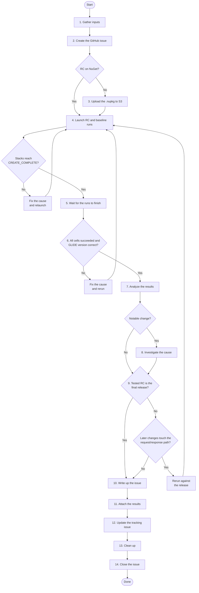

# Performance Testing Process

This document tells you how to do the performance tests for a Valkey GLIDE C# release. It starts when you create the
GitHub issue and ends when you close it.

The tests use [resp-bench](https://github.com/Bit-Quill/resp-bench) to compare the release candidate (RC) with two
baselines: the previous release, and StackExchange.Redis. You record the results in a sub-issue of the release tracking
issue.

- **Issue template:** [Performance Testing](../../.github/ISSUE_TEMPLATE/performance-testing.md).
- **Example:** issue #659, the performance testing for 1.2. Its tracking issue is #619.

> [!IMPORTANT]
> The issue and this repository are public. Do not post these items in issues, comments, or attachments:
>
> - AWS account IDs.
> - S3 bucket names, S3 paths, and job names.
> - Instance IDs.
> - Names of internal systems.

## Overview



## Prerequisites

- A checkout of resp-bench, on a branch that supports `--csharp-client-version` in `infra/aws/bench-aws.sh`.
  - Push the branch to <https://github.com/Bit-Quill/resp-bench>. The benchmark instances clone it from there.
  - Read `infra/README.md` in resp-bench to learn how the AWS runner works.
- AWS CLI access to the benchmarking account (`aws login`).
  - A session expires after a few hours. If a command fails with `Your session has expired`, log in again.
  - An expired session has no effect on a benchmark that is in progress.
- The GitHub CLI (`gh`), with a signed-in account.
- Python 3.

## Steps

### 1. Gather Inputs

Read the release tracking issue, and find these inputs:

1. The RC to test, for example `1.2.0-rc3`. To see if it is on NuGet, run:

   ```bash
   curl -s https://api.nuget.org/v3-flatcontainer/valkey.glide/index.json
   ```

1. The baseline. Use the published NuGet version of the previous release, for example `1.2.0` when you test 1.3.
   - Do not use a commit before the release tag. That commit can lack changes that shipped in the release.
   - If you use existing baseline results, make sure that they used the same instance type and workload.
1. The resp-bench branch to run.

### 2. Create the GitHub Issue

1. Open a new issue from the **Performance Testing** template:
   <https://github.com/valkey-io/valkey-glide-csharp/issues/new?template=performance-testing.md>. The template sets
   the title, type, and labels.
1. Replace the release version, tracking issue, and baseline version. Do not fill in the results yet.
1. Delete the instruction comment at the top of the body.
1. Set the milestone to `X.Y`, assign the issue to yourself, and create the issue.
1. Add the issue as a sub-issue of the tracking issue:

   ```bash
   R=repos/valkey-io/valkey-glide-csharp
   gh api -X POST $R/issues/<tracking issue>/sub_issues -F sub_issue_id=$(gh api $R/issues/<issue> --jq .id)
   ```

### 3. Upload the RC Package (If Not on NuGet)

If the RC is on NuGet, skip this step.

1. Upload the `.nupkg` file of the RC to the `inputs/` prefix of the results bucket. The benchmark instances can read
   only this prefix. The resp-bench `infra/README.md` file gives the bucket name.

   ```bash
   aws s3 cp Valkey.Glide.X.Y.Z-rcN.nupkg s3://<results bucket>/inputs/csharp/Valkey.Glide.X.Y.Z-rcN.nupkg
   ```

1. Make sure that the uploaded file is the same as the original. The two commands must show the same hash.

   ```bash
   shasum -a 256 Valkey.Glide.X.Y.Z-rcN.nupkg
   aws s3 cp s3://<results bucket>/inputs/csharp/Valkey.Glide.X.Y.Z-rcN.nupkg - | shasum -a 256
   ```

### 4. Launch the Runs

Run the RC and the baseline with the same matrix and instance type. If possible, run them at the same time.

Each run benchmarks GLIDE and StackExchange.Redis in 50 cells. On an `m5.2xlarge`, a run takes about 1.5 hours and
costs about $1 of on-demand EC2.

1. In the resp-bench checkout, do a dry run of the RC run. A dry run shows the plan and makes no changes in AWS.

   ```bash
   infra/aws/bench-aws.sh deploy --dry-run --matrix perf-csharp --instance-type m5.2xlarge --runtime-cap 240 \
     --repo-tag <resp-bench branch> --job-id-prefix csharp-X-Y-Z-rcN-perf --csharp-client-version X.Y.Z-rcN
   ```

   If you uploaded a `.nupkg` file in step 3, also add
   `--csharp-client-package s3://<results bucket>/inputs/csharp/Valkey.Glide.X.Y.Z-rcN.nupkg`.
1. Run the same command without `--dry-run`.
1. Launch the baseline in the same way. Use the baseline version and a different job ID prefix, for example
   `csharp-X-Y-Z-perf`.
1. Record each job ID from the `Launching run ...` line.

Do not put dots in the job ID prefix. CloudFormation stack names can contain only letters, digits, and hyphens.

### 5. Wait for the Runs

1. Wait for `deploy` to return. It returns when the instance is ready and the Valkey server answers, after about 15
   to 20 minutes.
1. If `deploy` fails while it waits, for example with a network error, do not launch the run again. The stack
   continues without the command. Check the stack directly:

   ```bash
   aws cloudformation list-stacks --region us-east-1 \
     --query "StackSummaries[?contains(StackName, 'csharp-X-Y-Z')].[StackName,StackStatus]" --output text
   ```

1. Look for the `CREATE_COMPLETE` status. This status shows that the benchmark has started.
1. If a stack rolls back, read `runs/<job id>/provision-failure.log` in the results bucket. Fix the cause and launch
   the run again.
1. When the run ends, the instance uploads its results to `runs/<job id>/` and stops itself. It does this whether the
   run passed or failed. If results appear a few minutes after `CREATE_COMPLETE`, the run failed early.

### 6. Check the Results

1. Download each run into a different directory:

   ```bash
   aws s3 cp --recursive s3://<results bucket>/runs/<job id>/results/latest/ <dir>/
   aws s3 cp s3://<results bucket>/runs/<job id>/run-metadata.json <dir>/
   ```

1. In `run-metadata.json`, make sure that:
   - `status` is `succeeded`.
   - `clients.valkey_glide_csharp.resolved` is the version that you requested.
1. In `_manifest.json`, make sure that `summary.failed` is 0.
1. For each failed cell, read its `error`. Then download `logs/cloud-init-output.log`, and search it for
   `Unhandled exception`.
1. In the `.ndjson` records, make sure that `metadata.primary_driver_version` shows the expected GLIDE version, for
   example `1.2.0-rc3+<commit>`.
1. If a check fails, fix the cause and run the affected runs again. Do not continue until all checks pass.

> [!NOTE]
> The resp-bench StackExchange.Redis client makes blocking calls. With 16 or more connections on an 8-vCPU host, these
> calls use all the threads in the .NET thread pool. Then the first `PING` times out after 5 seconds.
>
> To prevent this problem, the `perf-csharp` matrix sets `DOTNET_ThreadPool_ForceMinWorkerThreads=80` for the
> StackExchange.Redis cells. The value is hexadecimal, so it sets 128 threads. If the timeout occurs again, make sure
> that the matrix still sets this variable.

### 7. Analyze the Results

Use a script to read the raw `.ndjson` files and calculate every number in the write-up. Do not calculate by hand.

1. For each client and connection count, calculate the median of the `STEADY` phase values over the iterations:
   - Throughput, in requests per second: `totals.requests` / (`phase.duration_ms` / 1000).
   - Latency, in microseconds: `latency.summary.p50` and `p99` for `metrics.GET` and `metrics.SET`.
1. Calculate the percent changes from the medians before you round them. Calculate two changes:
   - From the GLIDE baseline to the GLIDE RC.
   - From StackExchange.Redis to the GLIDE RC.

   For latency, a negative change means lower latency.
1. Calculate the iteration spread: the standard deviation of throughput as a percentage of the mean. If the spread is
   more than a few percent, the instance was possibly noisy. Run the benchmark again.
1. List each connection count or percentile where the RC is worse than the baseline or StackExchange.Redis.
1. Use the same script to calculate the ranges in the summary.

### 8. Investigate Notable Changes

If performance changed noticeably in either direction, find the probable cause.

1. List the C# changes between the baseline tag and the RC tag:

   ```bash
   git log --oneline v<baseline>..v<RC> -- sources rust
   ```

1. Look for changes on the request and response path. This path includes `GlideString`, `ResponseHandler`,
   `Request.*`, `BaseClient`, the FFI layer, and `rust/src`.
1. Find the `valkey-glide` submodule commit at each tag with `git ls-tree <tag> valkey-glide`.
1. In a `valkey-glide` checkout, list the Rust core changes between the two submodule commits:

   ```bash
   git log --oneline <baseline submodule commit>..<RC submodule commit> -- glide-core glide-logger glide-telemetry
   ```

1. If one change looks like the cause, measure its cost alone. For example, write a small .NET program that times the
   old code path. Compare the result with the latency change at 1 connection.
1. In the write-up, call the cause "likely" unless you isolated it. To isolate a cause, benchmark the RC with the
   change reverted.

### 9. Compare the Tested RC With the Release

Do this step only if the release came from a later RC than the RC that you tested.

1. List the changes between the two tags, and compare their submodule commits:

   ```bash
   git log --oneline v<tested RC>..v<release> -- sources rust
   git ls-tree v<tested RC> valkey-glide
   git ls-tree v<release> valkey-glide
   ```

1. If the submodule commits are different, list the Rust core changes between them. Use the procedure in
   [step 8](#8-investigate-notable-changes).
1. If no change touches the request or response path, write this in the "Release candidate" bullet of the issue.
1. If a change touches the request or response path, benchmark the release again (step 4).

### 10. Write Up the Issue

1. Use the output of your script to fill in the Summary, Key Details, and Results sections of the issue body.
1. Get the commits, instance type, and Valkey version from `run-metadata.json`.
1. Get the .NET SDK version from `logs/cloud-init-output.log`.
1. Lint the body with `npx markdownlint-cli2`.
1. Compare the ranges in the summary with the tables again.
1. Update the issue:

   ```bash
   gh issue edit <issue> --repo valkey-io/valkey-glide-csharp --body-file issue-body.md
   ```

### 11. Attach the Results

1. Copy the files of each run into a different folder, for example `X.Y.Z-rcN/` and `X.Y.Z-baseline/`. The two runs
   use the same file names. Copy these files:
   - `_manifest.json`, `*.ndjson`, and `*.system.ndjson` from `results/latest/`.
   - `report.html` from the top-level folder of the run.
1. Do not copy `run-metadata.json` or `logs/`. They contain instance IDs, job IDs, and S3 paths.
1. Make sure that the files contain no data that must stay private. The command must show `clean`.

   ```bash
   grep -r -l -E '<account id>|<bucket name>|i-0[0-9a-f]{8,}|ip-172|/opt/resp-bench-runs|bench-20[0-9]{2}' <folder> \
     || echo clean
   ```

1. Zip the folders: `zip -r -X X.Y.Z-perf-results.zip <folder>`.
1. Drag the zip file into an issue comment or the issue description. The GitHub CLI and API cannot upload
   attachments.

### 12. Update the Tracking Issue

In the "Post-release candidate" table of the release tracking issue, update the "Performance" row:

- Set its status to ✅.
- Put a link to the performance testing issue in its Artifact column.
- Put the tested RC in its Notes column.

### 13. Clean Up

1. Make sure that the instance of each run has stopped.
1. Delete the remaining stack of each run. The stack contains a security group and an IAM role.

   ```bash
   infra/aws/bench-aws.sh delete resp-bench-<job id>
   ```

1. If you uploaded a `.nupkg` file, delete it from `inputs/` when the release is on NuGet.
1. Delete your local copies of the results and draft files.

### 14. Close the Issue

Close the issue when all of these conditions are true:

- The write-up is final.
- The results are attached.
- The tracking issue shows the result.

```bash
gh issue close <issue> --repo valkey-io/valkey-glide-csharp --reason completed
```
