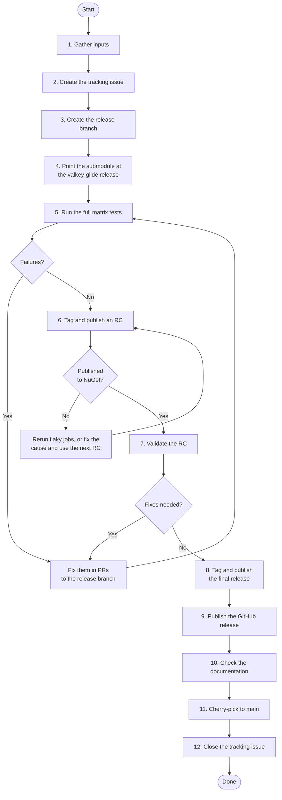

# Release Process

This document tells you how to make a Valkey GLIDE C# release. It starts when you create the release tracking issue and
ends when you close it.

Each C# release uses a release of the [`valkey-glide`](https://github.com/valkey-io/valkey-glide) core. You publish
one or more release candidates (RCs) before you publish the final release on NuGet and GitHub. You record all progress
in the release tracking issue.

- **Issue template:** [Release](../../.github/ISSUE_TEMPLATE/release.md).
- **Example:** issue #619, the tracking issue for 1.2.
- **Related:** two of the RC checks have their own process and sub-issue:
  - [`performance-testing-process.md`](performance-testing-process.md)
  - [`stability-testing-process.md`](stability-testing-process.md)

> [!IMPORTANT]
> The tracking issue and this repository are public. Do not post these items in issues, comments, or attachments:
>
> - AWS account IDs.
> - Internal test project names.
> - Names of internal systems.
>
> For the internal tests, record only the run ID.

## Overview



## Prerequisites

- Maintainer access to `valkey-io/valkey-glide-csharp`. You need it to push branches and tags, and to approve
  deployments in the `Release` environment.
- Membership of the `valkey` organization on nuget.org. You need it only to renew the NuGet API key (see step 6).
- The GitHub CLI (`gh`), with a signed-in account.
- A checkout of this repository. Its `upstream` remote must point at `valkey-io/valkey-glide-csharp`.
- Access to the internal test suite.
- Access to resp-bench, for the performance and stability tests.

## Steps

### 1. Gather Inputs

1. Find the C# version to release (for example, `1.2.0`).
1. Find the `valkey-glide` release for this C# release (for example, `2.6.0`). The two version numbers are different.
   To find the `valkey-glide` version, read its release tracking issue, or ask its maintainers.
1. Find the status of the `valkey-glide` release. Read its tracking issue, and check for its release branch
   (`release-a.b`) and release tag (`va.b.c`):

   ```bash
   git ls-remote --heads --tags https://github.com/valkey-io/valkey-glide.git 'release-a.b' 'va.b.c*'
   ```

The C# release must follow the `valkey-glide` release as closely as possible. If the `valkey-glide` release tag
exists, use it.

### 2. Create the Tracking Issue

1. Open a new issue from the **Release** template:
   <https://github.com/valkey-io/valkey-glide-csharp/issues/new?template=release.md>. The template sets the title,
   type, and label.
1. Replace the versions in the title and body. Do not tick the checklist items.
1. Delete the instruction comment at the top of the body.
1. Set the milestone to `X.Y`, assign the issue to yourself, and create the issue.

Update the issue at each step of the release:

- Set the status of each item, and link its artifact.
- Add each pull request to the Pull Requests section.
- Add each build to the Builds section.
- Add each new issue to the Issues section.

### 3. Create the Release Branch

Create the release branch `release-X.Y` (for example, `release-1.2`) from the latest commit on `main`:

```bash
git fetch upstream
git push upstream upstream/main:refs/heads/release-X.Y
```

After this step, make all changes to the release branch through pull requests. Do not push to it directly.

### 4. Point the Submodule at the valkey-glide Release

On the release branch, the `valkey-glide` submodule must point at the `valkey-glide` release branch, not at its
`main`. This makes the C# release use the same core as the `valkey-glide` release.

1. Open a pull request to the release branch.
1. In that pull request, update the submodule to the latest commit on the `valkey-glide` release branch. If the
   `valkey-glide` release tag exists, use the tag instead.

   ```bash
   git -C valkey-glide fetch origin release-a.b
   git -C valkey-glide checkout origin/release-a.b
   ```

1. Build the client with `task build`. Commit any changes to `rust/Cargo.lock`.
1. Update `CHANGELOG.md` for the release. Make sure that it includes every user-facing change since the previous
   release. For 1.2, this was #621.

When a fix lands on the `valkey-glide` release branch, update the submodule again in the same way. No automation does
this for you. Dependabot updates the submodule only on `main`.

To see the changes in a submodule update, and whether they change the Rust core, run:

```bash
git -C valkey-glide log --oneline <current>..<new> -- glide-core glide-logger glide-telemetry
```

Make fixes to the Rust core in `valkey-glide` first. Never change files in the submodule.

### 5. Run the Full Matrix Tests

The full matrix tests (FMT) run every test on every supported platform and server version.

1. Start a run on the release branch:

   ```bash
   gh workflow run nightly.yml -R valkey-io/valkey-glide-csharp --ref release-X.Y
   ```

1. Wait for the run to finish. To check its status, run `gh run view <id> --json status` in a loop.
1. Do not use `gh run watch`. It stops when GitHub returns a temporary error.
1. Read the logs of each failed job, and find the type of failure:
   - **Flaky test:** the test sometimes fails without a code change. If no issue exists for it, raise one with the
     `Flaky CI Test Issue` template.
   - **CI problem:** the test setup causes the failure, not the code. Fix it in a pull request to the release branch.
   - **Real failure:** the test fails every time. Fix it in a pull request to the release branch.
1. Repeat this step until every job passes. A pass on a rerun counts.

Notes:

- `gh run view --log-failed` works only after the run finishes. To read the logs of a job in a run that has not
  finished, download them from `/repos/valkey-io/valkey-glide-csharp/actions/jobs/<id>/logs`.
- You can rerun failed jobs only after the whole run finishes: `gh run rerun <id> --failed`.
- The coverage job fails if line or branch coverage changes by more than 0.1 percentage points, up or down. If this
  occurs, update `dev/conf/coverage-baseline.json` to the new values in a pull request.

### 6. Tag and Publish a Release Candidate

1. Make sure that the submodule points at the latest commit on the `valkey-glide` release branch (step 4).
1. Find the next unused RC number. Use it even if an earlier RC was not published.

   ```bash
   git ls-remote --tags upstream 'vX.Y*'
   ```

1. Never move or delete a tag after you push it. Other people can have fetched it already.
1. Create a lightweight tag, with no message, on the latest commit of the release branch. Then push the tag:

   ```bash
   git fetch upstream
   git tag vX.Y.Z-rcN <commit>
   git push upstream vX.Y.Z-rcN
   ```

1. Monitor the release workflow (`cd.yml`) that the tag starts. The workflow does these tasks:
   1. It builds the native libraries for every platform.
   1. It creates the NuGet package.
   1. It runs the full matrix tests against the package.
   1. It publishes the package to NuGet.
1. If jobs fail only because of flaky tests or a temporary CI problem, rerun the failed jobs. A network timeout during
   setup is an example of a temporary CI problem. Do not rerun more than two times.
1. If the same test continues to fail, or a failure looks real, fix it. Then use the next RC number.
1. When the tests pass, the publish job waits for approval in the `Release` environment. Approve it under "Review
   deployments" in the run.
1. Make sure that the version is on NuGet. NuGet indexes a new version 2 to 15 minutes after the push.

   ```bash
   curl -s https://api.nuget.org/v3-flatcontainer/valkey.glide/index.json
   ```

1. Add the RC to the Builds table in the tracking issue. Add it even if it was not published.

> [!NOTE]
> A rerun uses the workflow file from the tagged commit. Thus, a workflow fix that you merge after the tag has no
> effect on a rerun. If you must change the workflow, merge the change and use the next RC number.

#### If the NuGet API Key Has Expired

The publish job can fail with this error:
`403 (The specified API key is invalid, has expired, or does not have permission ...)`.
This error means that the `NUGET_API_KEY` secret has expired. A NuGet API key is valid for a maximum of 365 days.
To replace the key:

1. A member of the `valkey` organization on nuget.org creates a new key with these settings:
   - Package owner: `valkey`.
   - Scope: "Push only new package versions".
   - Glob pattern: `Valkey.Glide`.
1. A repository admin updates the secret.
1. You rerun the failed job.

Issue #656 tracks a change to Trusted Publishing, which does not use an API key.

### 7. Validate the Release Candidate

Do these checks on the published RC. Record each check in the "Post-release candidate" table.

1. **Full matrix tests:** start a run at the RC tag (`gh workflow run nightly.yml --ref vX.Y.Z-rcN`).
1. **Internal tests:** run the internal test suite against the RC. Record only the run ID.
1. **Internal bug bash and AppSec review:** add each issue that they find to the Issues section.
1. **Performance:** follow [`performance-testing-process.md`](performance-testing-process.md).
1. **Stability:** follow [`stability-testing-process.md`](stability-testing-process.md).

If a check finds a problem, fix it in a pull request to the release branch (step 5). Then publish the next RC
(step 6). Repeat until an RC passes every check.

### 8. Tag and Publish the Final Release

You cannot replace or delete a published NuGet version. You can only unlist it. Thus, build the final release from the
same commit as the RC that passed validation.

1. Make sure that the release branch has not changed since that RC. The two commands must show the same commit.

   ```bash
   git fetch upstream release-X.Y --tags
   git rev-parse upstream/release-X.Y vX.Y.Z-rcN^{commit}
   ```

1. Create the tag `vX.Y.Z` on that commit, and push it.
1. Do the remaining tasks from step 6:
   1. Monitor the run.
   1. Rerun flaky jobs.
   1. Approve the publish job.
   1. Make sure that the version is on NuGet.
1. Add the release to the Builds table.
1. In the "Release" table, set the status of both items to ✅.

### 9. Publish the GitHub Release

1. Write the release notes in the same style as earlier releases, for example v1.1.0 and v1.2.0. Include these
   sections:
   - "🚀 What's Changed". Put the changes under headings by theme, for example Commands, Configuration, Reliability,
     Breaking Changes, and Security. Write a short bullet for each change, and cite its pull request.
   - A link to the changelog for the full list of changes.
   - "🎉 New Contributors".
   - A "Full Changelog" link (`compare/v<previous>...vX.Y.Z`).
1. Compare each claim with the changelog and the code. List a command as supported only if the client supports it,
   directly or through a GLIDE API.
1. Create a draft release for the tag:

   ```bash
   gh release create vX.Y.Z -R valkey-io/valkey-glide-csharp --draft --verify-tag --title vX.Y.Z \
     --notes-file release-notes.md
   ```

1. When the version is on NuGet, publish the release:

   ```bash
   gh release edit vX.Y.Z -R valkey-io/valkey-glide-csharp --draft=false --latest
   ```

### 10. Check the Documentation

The [`valkey-glide-docs`](https://github.com/valkey-io/valkey-glide-docs) repository contains the source of the GLIDE
documentation at [glide.valkey.io](https://glide.valkey.io/).

1. Check the C# column of the [Supported Features](https://glide.valkey.io/reference/supported-features/) page. Its
   source is `src/data/supported-features/csharp.json`. Make sure that:
   - The `version` value is correct.
   - Each new feature has a "since X.Y.Z" entry.
   - Each unsupported feature is `not_available`, with a link to its tracking issue.
1. Check the C# column of the [Supported Commands](https://glide.valkey.io/commands/supported-commands/) page. Its
   source is `src/data/available-commands.json`. Compare it with the commands that the release adds.
1. If a page is not correct, update it in a pull request to `valkey-glide-docs`. For 1.2, this was
   valkey-io/valkey-glide-docs#373.
1. Make sure that the latest deployment of the documentation succeeded, and that the site shows the new content.
1. Link the workflow run of that deployment in the tracking issue.

### 11. Cherry-Pick to main

1. Open a pull request to `main`. In it, cherry-pick every pull request that was merged into the release branch, in
   merge order. For 1.2, this was #658.
1. Do not cherry-pick the submodule updates. On `main`, the submodule follows `valkey-glide` `main`.
1. Make sure that `main` will get every change from the release branch. To do this, merge the release branch into the
   pull request branch in memory:

   ```bash
   git fetch upstream release-X.Y pull/<PR>/head:cherry-pick-check
   git merge-tree --write-tree --name-only cherry-pick-check upstream/release-X.Y
   ```

   The command must show conflicts only in the submodule and `rust/Cargo.lock`. A conflict in a different file means
   that a change is missing.

   If the command fails with `commit-graph is likely corrupt`, add `-c core.commitGraph=false` after `git`.
1. Some fixes come in through the submodule, for example security fixes. Make sure that these fixes are also in the
   `valkey-glide` commit that `main` uses.

### 12. Close the Tracking Issue

Close the tracking issue when both of these conditions are true:

- Each item is ticked, ✅, or 🏳️ (not applicable).
- The cherry-pick pull request is merged.

```bash
gh issue close <issue> --repo valkey-io/valkey-glide-csharp --reason completed
```
