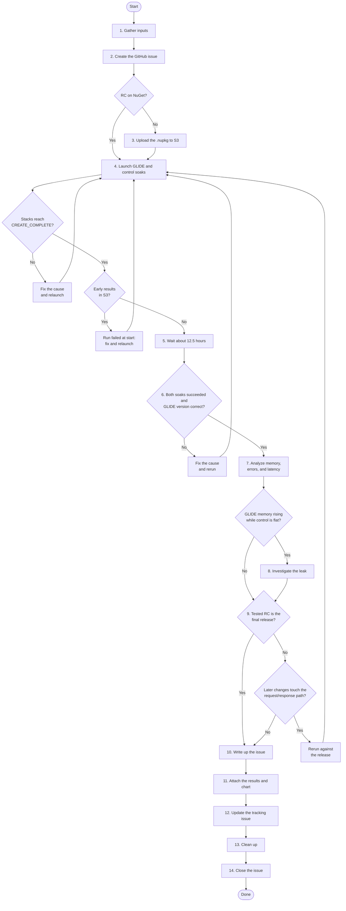

# Stability Testing Process

This document tells you how to do the stability tests for a Valkey GLIDE C# release. It starts when you create the
GitHub issue and ends when you close it.

The tests use [resp-bench](https://github.com/Bit-Quill/resp-bench) to run the release candidate (RC) at full load for
12 hours. A StackExchange.Redis control run occurs at the same time. You look for errors and memory growth, and you
record the results in a sub-issue of the release tracking issue.

- **Issue template:** [Stability Testing](../../.github/ISSUE_TEMPLATE/stability-testing.md).
- **Example:** issue #660, the stability testing for 1.2. Its tracking issue is #619.
- **Related:** [`performance-testing-process.md`](performance-testing-process.md) uses the same tools. If possible,
  run the two tests on the same RC at the same time.

> [!IMPORTANT]
> The issue and this repository are public. Do not post these items in issues, comments, or attachments:
>
> - AWS account IDs.
> - S3 bucket names, S3 paths, and job names.
> - Instance IDs.
> - Names of internal systems.

## Overview



## Prerequisites

- A checkout of resp-bench, on a branch with these properties:
  - It supports `--csharp-client-version` in `infra/aws/bench-aws.sh`.
  - It has the `soak-csharp` and `soakctl-csharp` matrices.
  - It is pushed to <https://github.com/Bit-Quill/resp-bench>. The benchmark instances clone it from there.

  Read `infra/README.md` in resp-bench to learn how the AWS runner works.
- AWS CLI access to the benchmarking account (`aws login`).
  - A session expires after a few hours. If a command fails with `Your session has expired`, log in again.
  - An expired session has no effect on a soak that is in progress.
- The GitHub CLI (`gh`), with a signed-in account.
- Python 3 with `matplotlib`, for the chart.

## Steps

### 1. Gather Inputs

Read the release tracking issue, and find these inputs:

1. The RC to test, for example `1.2.0-rc3`. To see if it is on NuGet, run:

   ```bash
   curl -s https://api.nuget.org/v3-flatcontainer/valkey.glide/index.json
   ```

1. The resp-bench branch to run.
1. Whether to also soak the previous release as a baseline. A baseline soak is optional:
   - The StackExchange.Redis control shows if memory growth comes from GLIDE or from the benchmark harness.
   - A baseline soak adds 12.5 hours and costs about $5.

### 2. Create the GitHub Issue

1. Open a new issue from the **Stability Testing** template:
   <https://github.com/valkey-io/valkey-glide-csharp/issues/new?template=stability-testing.md>. The template sets the
   title, type, and labels.
1. Replace the release version and tracking issue. Do not fill in the results yet.
1. Delete the instruction comment at the top of the body.
1. Set the milestone to `X.Y`, assign the issue to yourself, and create the issue.
1. Add the issue as a sub-issue of the tracking issue:

   ```bash
   R=repos/valkey-io/valkey-glide-csharp
   gh api -X POST $R/issues/<tracking issue>/sub_issues -F sub_issue_id=$(gh api $R/issues/<issue> --jq .id)
   ```

### 3. Upload the RC Package (If Not on NuGet)

If the RC is on NuGet, skip this step. If you uploaded the package for the performance tests, also skip this step.

1. Upload the `.nupkg` file of the RC to the `inputs/` prefix of the results bucket. The benchmark instances can read
   only this prefix. The resp-bench `infra/README.md` file gives the bucket name.

   ```bash
   aws s3 cp Valkey.Glide.X.Y.Z-rcN.nupkg s3://<results bucket>/inputs/csharp/Valkey.Glide.X.Y.Z-rcN.nupkg
   ```

1. Make sure that the uploaded file is the same as the original. The two commands must show the same hash.

   ```bash
   shasum -a 256 Valkey.Glide.X.Y.Z-rcN.nupkg
   aws s3 cp s3://<results bucket>/inputs/csharp/Valkey.Glide.X.Y.Z-rcN.nupkg - | shasum -a 256
   ```

### 4. Launch the Soaks

Launch the GLIDE soak and the StackExchange.Redis control at the same time. Use a different instance for each soak,
with the same instance type.

Each soak runs for 12 hours, plus about 30 minutes to prepare the instance. On an `m5.2xlarge`, a soak costs about $5
of on-demand EC2.

1. In the resp-bench checkout, do a dry run of the GLIDE soak. A dry run shows the plan and makes no changes in AWS.

   ```bash
   infra/aws/bench-aws.sh deploy --dry-run --matrix soak-csharp --instance-type m5.2xlarge --runtime-cap 780 \
     --repo-tag <resp-bench branch> --job-id-prefix csharp-X-Y-Z-rcN-soak --csharp-client-version X.Y.Z-rcN
   ```

   If you uploaded a `.nupkg` file in step 3, also add
   `--csharp-client-package s3://<results bucket>/inputs/csharp/Valkey.Glide.X.Y.Z-rcN.nupkg`.
1. Run the same command without `--dry-run`.
1. Launch the control in the same way. Use `--matrix soakctl-csharp` and a different job ID prefix, for example
   `csharp-X-Y-Z-rcN-soakctl`.
1. For the control, use the same `--csharp-client-version` value. The control does not use GLIDE, but the same value
   keeps the builds on the two instances the same.
1. Record each job ID from the `Launching run ...` line.

Notes:

- `--runtime-cap 780` (13 hours) gives time to prepare the instance and upload the results. The instance stops itself
  at the cap. Thus, a lower cap can stop the soak before it finishes.
- Do not put dots in the job ID prefix. CloudFormation stack names can contain only letters, digits, and hyphens.

### 5. Wait for the Soaks

1. Wait for `deploy` to return. It returns when the instance is ready and the Valkey server answers, after about 15
   to 20 minutes.
1. If `deploy` fails while it waits, for example with a network error, do not launch the soak again. The stack
   continues without the command. Check the stack directly:

   ```bash
   aws cloudformation list-stacks --region us-east-1 \
     --query "StackSummaries[?contains(StackName, 'csharp-X-Y-Z')].[StackName,StackStatus]" --output text
   ```

1. Look for the `CREATE_COMPLETE` status. This status shows that the soak has started.
1. If a stack rolls back, read `runs/<job id>/provision-failure.log` in the results bucket. Fix the cause and launch
   the soak again.
1. About 15 minutes after `CREATE_COMPLETE`, make sure that `runs/<job id>/` is empty.
   - A soak that fails at start-up uploads its results and stops within one or two minutes. An example is a failure on
     the first request.
   - If you do not do this check, you find the failure only after 12 hours.
1. When the soak ends, the instance uploads its results to `runs/<job id>/` and stops itself.

### 6. Check the Results

1. Download each soak into a different directory:

   ```bash
   aws s3 cp --recursive s3://<results bucket>/runs/<job id>/results/latest/ <dir>/
   aws s3 cp s3://<results bucket>/runs/<job id>/run-metadata.json <dir>/
   ```

1. In `run-metadata.json`, make sure that:
   - `status` is `succeeded`.
   - For the GLIDE soak, `clients.valkey_glide_csharp.resolved` is the version that you requested.
1. In `_manifest.json`, make sure that the single cell succeeded.
1. If the cell failed, read its `error`. Then download `logs/cloud-init-output.log`, and search it for
   `Unhandled exception`.
1. In the `.ndjson` file, find the `STEADY` record, and make sure that:
   - `phase.duration_ms` is about 43,200,000 (12 hours). A value a few milliseconds higher is normal.
   - `metadata.primary_driver_version` shows the expected GLIDE version, for example `1.2.0-rc3+<commit>`.
1. Make sure that the `.system.ndjson` samples cover all 12 hours, at about one sample every 5 seconds.
1. If a check fails, fix the cause and run the affected soak again. Do not continue until all checks pass.

> [!NOTE]
> The resp-bench StackExchange.Redis client makes blocking calls. With 16 or more connections on an 8-vCPU host, these
> calls use all the threads in the .NET thread pool. Then the first `PING` times out after 5 seconds.
>
> To prevent this problem, the `soakctl-csharp` matrix sets `DOTNET_ThreadPool_ForceMinWorkerThreads=80`. The value
> is hexadecimal, so it sets 128 threads. If the timeout occurs again, make sure that the matrix still sets this
> variable.

### 7. Analyze the Results

Use a script to read the raw files and calculate every number in the write-up. Do not calculate by hand.

1. **Memory:** use `memory_rss_bytes` in `.system.ndjson`. For each soak, calculate:
   - The RSS at the first sample.
   - The median RSS of each hour.
   - The change in median RSS from hour 1 to the last full hour (hour 11), in MiB and percent.
   - The least-squares slope of RSS from hour 1, in MiB per hour.
   - The RSS range from hour 1.

   Do not use hour 0. RSS increases during start-up, while the runtime and connections warm up.
1. **Throughput and errors:** use the `STEADY` record. Calculate:
   - `totals.requests` and `totals.errors`.
   - Requests per second: `totals.requests` / (`phase.duration_ms` / 1000).
   - The median `cpu_percent` from `.system.ndjson`.
1. **Latency:** use the `STEADY` record. For `metrics.GET` and `metrics.SET`, get the `latency.summary` values `p50`,
   `p99`, `p999`, and `max`, in microseconds. Calculate the GLIDE change relative to StackExchange.Redis.
1. **Chart:** plot the RSS of the two soaks against the elapsed hours on one chart. Start the y-axis at 0, so that
   small changes do not look large.

Use these rules to read the results:

- **Memory:**
  - A flat GLIDE line after start-up shows that there is no leak.
  - A GLIDE line that continues to increase while the control stays flat points at GLIDE.
  - Two lines that increase together point at the harness or the host.
  - RSS includes the whole benchmark process group, with the `make` and `dotnet run` host processes. Thus, compare
    trends, not absolute values.
- **Throughput:**
  - The workload has no rate limit, and the client and server share the CPUs of the host. Thus, the two soaks usually
    use all of the host, at about 90% CPU.
  - At full CPU, the throughput shows the limit of the test setup, not of the client. Use throughput to show that the
    load stayed high. Do not use it to compare the clients. The performance tests compare the clients.
- **Latency:**
  - At full CPU, p50 and p99 show mostly the queues on the host. Give this caveat with each comparison.
  - Large differences in `max` more probably come from the client, for example from garbage-collection or thread-pool
    pauses.
- **Errors:** explain each error before sign-off.

### 8. Investigate a Leak

Do this step only if the GLIDE memory continues to increase while the control stays flat.

1. Look at the shape of the growth in the hourly medians:
   - Steady growth points at a leak on each request.
   - Steps point at a periodic allocation, for example a cache or buffer that grows.
1. List the C# and `glide-core` changes since the previous release. Use the procedure in
   [step 8 of the performance testing process](performance-testing-process.md#8-investigate-notable-changes).
1. Look for changes to resource handling, for example in these areas:
   - `MessageContainer` and `ResponseHandler`.
   - The FFI layer and `rust/src`.
   - Connection and pub/sub management.
1. Reproduce the leak locally with a shorter soak, for example a few hours with the same workload.
1. Use .NET diagnostic tools (`dotnet-counters`, `dotnet-gcdump`) to find whether the growth is in the managed heap or
   in native memory.
1. Raise an issue for the leak, and link it from the stability issue.

### 9. Compare the Tested RC With the Release

Do this step only if the release came from a later RC than the RC that you tested.

1. List the changes between the two tags, and compare their submodule commits:

   ```bash
   git log --oneline v<tested RC>..v<release> -- sources rust
   git ls-tree v<tested RC> valkey-glide
   git ls-tree v<release> valkey-glide
   ```

1. If the submodule commits are different, list the Rust core changes between them. Use the procedure in
   [step 8 of the performance testing process](performance-testing-process.md#8-investigate-notable-changes).
1. If no change touches the request or response path, write this in the "Release candidate" bullet of the issue.
1. If a change touches the request or response path, soak the release again (step 4).

### 10. Write Up the Issue

1. Use the output of your script to fill in the Summary, Key Details, and Results sections of the issue body.
1. Get the commits, instance type, and Valkey version from the `run-metadata.json` file of each soak.
1. Get the .NET SDK version from the `logs/cloud-init-output.log` file of each soak.
1. Lint the body with `npx markdownlint-cli2`.
1. Compare the figures in the summary with the tables again.
1. Update the issue:

   ```bash
   gh issue edit <issue> --repo valkey-io/valkey-glide-csharp --body-file issue-body.md
   ```

### 11. Attach the Results and Chart

1. Copy the files of each soak into a different folder, for example `valkey-glide-csharp/` and
   `stackexchange-redis-control/`. Copy these files:
   - `_manifest.json`, `*.ndjson`, and `*.system.ndjson` from `results/latest/`.
   - `report.html` from the top-level folder of the soak.
1. Add the RSS chart (PNG) at the top level.
1. Do not copy `run-metadata.json` or `logs/`. They contain instance IDs, job IDs, and S3 paths.
1. Make sure that the files contain no data that must stay private. The command must show `clean`.

   ```bash
   grep -r -l -E '<account id>|<bucket name>|i-0[0-9a-f]{8,}|ip-172|/opt/resp-bench-runs|bench-20[0-9]{2}' <folder> \
     || echo clean
   ```

1. Zip the folders: `zip -r -X X.Y.Z-stability-results.zip <folder>`.
1. Drag the zip file into an issue comment or the issue description. The GitHub CLI and API cannot upload
   attachments.
1. Also drag the chart into the issue, so that the issue shows it.

### 12. Update the Tracking Issue

In the "Post-release candidate" table of the release tracking issue, update the "Stability test" row:

- Set its status to ✅.
- Put a link to the stability testing issue in its Artifact column.
- Put the tested RC in its Notes column.

### 13. Clean Up

1. Make sure that the instance of each soak has stopped.
1. Delete the remaining stack of each soak. The stack contains a security group and an IAM role.

   ```bash
   infra/aws/bench-aws.sh delete resp-bench-<job id>
   ```

1. If you uploaded a `.nupkg` file, delete it from `inputs/` when both of these conditions are true:
   - The release is on NuGet.
   - The performance tests are complete.
1. Delete your local copies of the results and draft files.

### 14. Close the Issue

Close the issue when all of these conditions are true:

- The write-up is final.
- The results are attached.
- The tracking issue shows the result.

```bash
gh issue close <issue> --repo valkey-io/valkey-glide-csharp --reason completed
```
